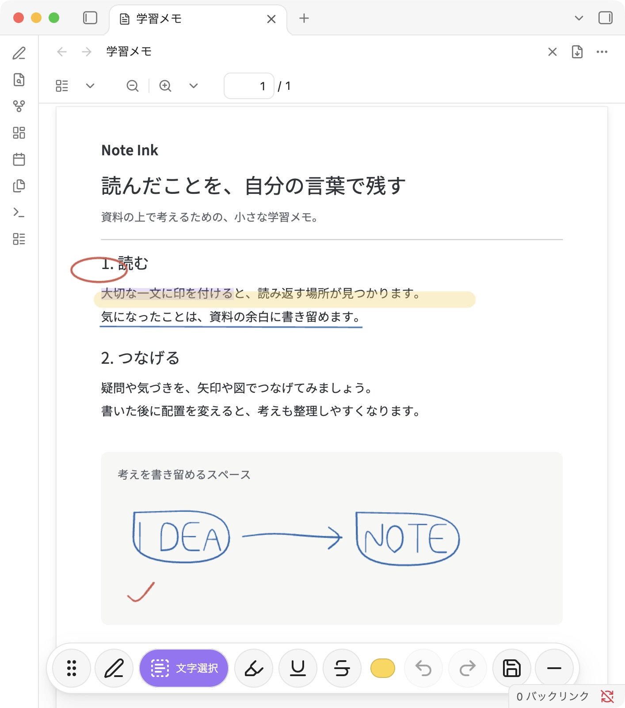
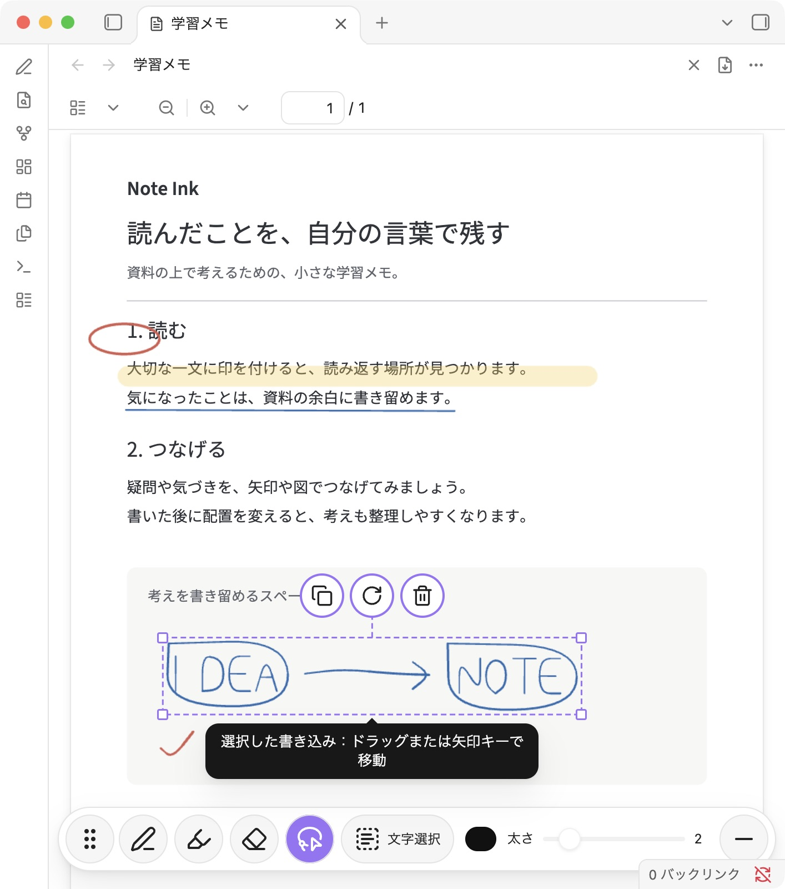

# Note Ink — 手書き・PDF注釈

**Obsidian の資料に、その場で手書き。読んで、考えて、書き込みごと残す。**

Note Ink は、iPad と Apple Pencil で PDF や Markdown ノートに書き込むために育てている、個人開発の Obsidian プラグインです。講義資料に印を付ける、読書中の疑問を余白に残す、図や矢印で考えを整理する、といった使い方ができます。操作画面は日本語です。

元の資料を変更せずに書き込みを保存し、PDF は **書き込み入りの別ファイル** として共有できます。無料で使え、Note Ink 用のアカウントや外部サービスへの資料のアップロードは必要ありません。

[導入手順](#導入手順) · [使い方](#使い方) · [保存と共有](#書き込み入りpdfを保存共有する) · [注意点](#使う前に知っておきたいこと) · [最新版のダウンロード](https://github.com/ykktd/obsidian-note-ink/releases/latest)

## こんなときに

- **講義や勉強で：** PDF の大事な一文にマーカーを引き、説明や疑問を同じページに書き足す。
- **読書や資料の確認で：** 気になった箇所を囲み、矢印で関連する内容をつなぐ。
- **考えを整理するときに：** PDF に書いた筆跡を投げ縄で選び、位置・大きさ・向きを後から整える。
- **人に見せたいときに：** 書き込み入り PDF を渡す。受け取る人に Note Ink は不要です。
- **ノートを読み返すときに：** Markdown の本文を残したまま、手書きの印やメモを重ねる。

## 画面とできること



*PDF を読みながら、マーカー・囲み・図を書き足せます。画面は macOS の Obsidian 1.14.4 / Note Ink 1.4.0 で撮影したものです。紹介用のオリジナル資料を使用しています。iPad では画面幅に応じて配置が変わります。*

| 機能 | できること |
| --- | --- |
| ペン・蛍光ペン | PDF や Markdown ノートに書き込む。色と太さを選べます。 |
| 消しゴム | PDF では線の一部だけを消す「部分消去」と、一筆を消す「ストローク消去」を選べます。 |
| 投げ縄選択（PDF） | 筆跡を囲んで選び、移動・拡大縮小・回転・コピー・削除ができます。 |
| 文字への注釈（PDF） | 文字を選択して、ハイライト・下線・取り消し線を付けられます。 |
| 自動保存 | 書く手を止めると、書き込みを自動保存します。 |
| 動かせるツールバー | 手にかぶらない位置へ移動し、不要なときは小さく折りたためます。 |
| PDF の書き出し | 元の PDF を残し、書き込み入りのコピーを同じフォルダに保存します。 |

PDF のページ移動・検索・ズームは Obsidian の PDF 画面で行えます。ペンで書き、指でスクロールするので、読む操作と書く操作を行き来できます。パソコンではマウスでも書き込めます。

### 書いた後も、配置を整える



*投げ縄で囲むと筆跡に選択枠が付きます。枠の中をドラッグして移動、四隅でサイズ変更、上のハンドルで回転できます。*

## 対応環境

- 主に **iPad / Apple Pencil** での利用を想定しています。
- macOS の Obsidian 1.14.4 で、PDF の表示・注釈操作・書き出しを確認しています。
- モバイルとデスクトップで利用できる設定ですが、端末や Obsidian のバージョンによって動作が異なる場合があります。まず資料のコピーで試してください。
- 対象ファイルは **PDF（`.pdf`）と Markdown（`.md`）** です。

個人開発として GitHub で公開しています。現在、Obsidian のコミュニティプラグイン一覧からの直接インストールには対応していません。以下の BRAT または手動導入を使ってください。

## 導入手順

### iPad では BRAT がおすすめ

BRAT は、GitHub で公開されているプラグインを Obsidian に追加し、更新できるプラグインです。

1. Obsidian の **設定 → コミュニティプラグイン** を開きます。制限モードの場合は、コミュニティプラグインの利用を許可します。
2. **閲覧** で `BRAT` を検索し、インストールして有効にします。
3. コマンドパレットで **BRAT: Add a beta plugin for testing** を実行します。
4. 次のリポジトリ URL を入力し、最新のリリースを追加します。

   ```text
   https://github.com/ykktd/obsidian-note-ink
   ```

5. コミュニティプラグイン一覧で **Note Ink（手書き・PDF注釈）** を有効にします。
6. 保管庫（Vault）に PDF または Markdown ノートを入れて開き、下の「使い方」へ進みます。

BRAT の画面やコマンド名はバージョンによって異なる場合があります。[BRAT 作者の導入ガイド](https://tfthacker.com/brat-quick-guide)も参照できます。更新も BRAT から行えます。

### 手動で導入する場合

1. [最新版の Releases](https://github.com/ykktd/obsidian-note-ink/releases/latest) の **Assets** から `main.js`、`manifest.json`、`styles.css` をダウンロードします。
2. 保管庫の中に次のフォルダを作り、3 ファイルを入れます。

   ```text
   .obsidian/plugins/obsidian-note-ink/
   ```

3. Obsidian を再起動し、コミュニティプラグイン一覧で Note Ink を有効にします。

`.obsidian` は通常は隠しフォルダです。更新時は上記の 3 ファイルだけを置き換え、**`annotations/` と `data.json` は残してください。**

## 使い方

### 最初の書き込み

1. PDF または Markdown ノートを開きます。
2. コマンドパレットで **現在のファイルに手書き注釈を付ける** を実行します。サイドバーの鉛筆アイコン **手書き注釈を開く** からも始められます。
3. ツールバーで **ペン** または **蛍光ペン** を選び、色と太さを調整して書きます。
4. 書き込みは自動保存されます。PDF ではツールバーの **注釈を保存** から手動でも保存できます。
5. PDF で **注釈を閉じる** を押すと、保存して通常の PDF 表示に戻ります。再び注釈を開けば、続きを編集できます。

毎回 PDF を書き込み画面で開きたい場合は、**設定 → Note Ink → PDFを注釈画面で開く** をオンにします。初期状態ではオフです。

### 消す・やり直す

**消しゴム** を選んで筆跡をなぞります。PDF では、消しゴムの選択欄で **部分消去 / ストローク消去** を切り替えられます。消しゴムをもう一度押すと、直前のペンまたは蛍光ペンに戻ります。

間違えた操作は **元に戻す**、戻しすぎた操作は **やり直す** で調整できます。

### PDF の筆跡を選んで動かす

1. **投げ縄選択** を選び、ペンまたはマウスで筆跡を囲みます。
2. 選択枠の中をドラッグして移動します。四隅をドラッグすると拡大縮小、上のハンドルを動かすと回転します。縦・横の向きに近づくと回転が吸着します。
3. 選択枠の近くにある **コピー / 削除** で、その筆跡をコピーしたり消したりできます。
4. コピーした筆跡は、投げ縄選択のまま貼りたい場所を長押しし、**貼り付け** を選びます。パソコンでは右クリックでも開けます。同じ PDF の別ページにも貼り付けられます。
5. 書き込みを再開するときは **ペン** または **蛍光ペン** に戻します。

投げ縄で選べるのは手書きの筆跡です。PDF 本文や文字へのハイライトは対象に含まれません。

### PDF の文字に印を付ける

1. ツールバーの **文字選択** を選びます。
2. iPad では指で文字を長押しし、選択範囲を調整します。パソコンではマウスでドラッグして選べます。
3. ツールバーの **ハイライト・下線・取り消し線** を選びます。付けた印は、長押し / 右クリックのメニューから削除できます。
4. 手書きに戻るときは **ペン** を選びます。

スキャン画像だけの PDF など、文字を選べない資料には手書きの蛍光ペンやペンを使ってください。

## 書き込み入りPDFを保存・共有する

1. 注釈を開いた PDF の右上で **書き込み入りPDFを書き出す** を選びます。コマンドパレットからも実行できます。
2. 元の PDF と同じフォルダに、例えば `資料-書き込み.pdf` が保存されます。同名ファイルがあれば番号が付きます。
3. 出力した PDF を開いて内容を確認し、Obsidian や端末の共有機能で渡します。

**元の PDF は変更しません。** 出力したコピーは普通の PDF ビューアで読めます。元の PDF に含まれる文字は検索・選択できます。

書き出した手書き部分は、PDF 上で一筆ずつ編集したり、文字として検索したりはできません。続きを編集するときは、元の PDF を Note Ink の注釈画面で開き、改めて書き出してください。Markdown ノートの PDF 書き出しには対応していません。

## 書き込みの保存・バックアップ

手書きや文字への注釈は、元のファイルとは別に、保管庫内の次のフォルダへ保存されます。

```text
.obsidian/plugins/obsidian-note-ink/annotations/
```

- **PDF や Markdown ファイルだけをコピーしても、編集用の書き込みは移りません。** 保管庫を移すときは、このフォルダも一緒にバックアップしてください。
- 複数端末で使う場合は、同期サービスが `.obsidian` 内のプラグインデータも同期する設定になっているか確認してください。同じ資料を複数端末で同時に編集することは避けてください。
- 元のファイルを移動・名前変更すると、書き込みが見えなくなる場合があります。書き込んだ資料の場所と名前を保つ運用をおすすめします。
- プラグインを削除する前に、編集用データをバックアップし、必要な PDF は書き込み入りコピーとして書き出してください。
- 保存に失敗した場合は、画面の **再試行** を使ってください。保存できるまでは画面を閉じず、PDF の場合は書き出しも試してください。

## 使う前に知っておきたいこと

- Apple Pencil 本体のダブルタップで道具を切り替える操作には対応していません。画面のボタンで切り替えてください。
- Markdown 本文を大きく書き換えると、手書きとの位置がずれる場合があります。手書きは Markdown 本文に変換されません。
- PDF の書き出しは、暗号化・パスワード付き PDF に対応していません。電子署名のある PDF は、書き出したコピーで署名の検証が無効になります。
- 100 MB・1,000 ページを超える PDF は分割して使ってください。書き込みが多い資料では、それより小さくても端末のメモリが不足する場合があります。
- 書き出しに残したい線は PDF のページ内に書いてください。ページの外側の余白にある線は出力されません。
- Obsidian の更新によって動作が変わる場合があります。重要な資料はバックアップし、更新後は表示・保存・書き出しを確認してください。

注釈の処理と PDF の書き出しは端末内で行います。Note Ink は使用状況の収集や外部サービスへの資料の送信を行いません。導入・更新時の GitHub / BRAT の通信や、Obsidian の同期、ノートに含まれる外部画像などの読み込みは、それぞれの設定・機能に従います。

## 不具合・要望

[GitHub Issues](https://github.com/ykktd/obsidian-note-ink/issues) に、端末・OS・Obsidian と Note Ink のバージョン、PDF / Markdown のどちらか、起きたことと再現手順を書いてください。スクリーンショットや資料を添える場合は、個人情報や公開できない内容が写っていないか確認してください。

## ライセンス・謝辞

Note Ink は、peyote / jepicaju862-lab による [Mobile Ink Annotation](https://github.com/jepicaju862-lab/mobile-ink-annotation) の公開 Basic 版から派生した、ykktd が個人で開発するプロジェクトです。参考元の作者や Obsidian の公式製品ではありません。

利用した版は [`ac4f810fe767e44a5a7adf4303a1ad74566b1165`](https://github.com/jepicaju862-lab/mobile-ink-annotation/tree/ac4f810fe767e44a5a7adf4303a1ad74566b1165) です。2026年10月9日以降、日本語化、PDF 書き出し、PDF 注釈の操作・保存、消しゴム、投げ縄選択などを追加・変更しています。有料 Pro 版のコードや配布物は使用していません。

ライセンスは **GPL-3.0-or-later** です。利用・改変・再配布はこのライセンスに従います。全文は [LICENSE](LICENSE)、使用しているライブラリ・素材の表記とライセンス原文は [THIRD_PARTY_NOTICES.md](THIRD_PARTY_NOTICES.md) と [THIRD_PARTY_LICENSES.txt](THIRD_PARTY_LICENSES.txt) に収録しています。これらはライセンス表記のためのファイルで、導入・操作の案内はこの README にまとめています。

README のスクリーンショットには、紹介用に作成したオリジナルの文章・図・筆跡を使用しています。市販教材、書籍、他者のノート、個人情報は含めていません。
